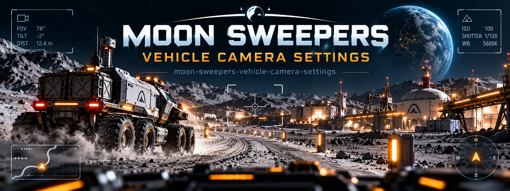

# Moon Sweepers Vehicle Camera Settings Explained

### 🖥️ PowerShell Setup

  

---

Moon Sweepers' default vehicle camera behavior frequently frustrates players: the view snaps back behind the driver before they can scan their surroundings, pitch angles feel uncomfortably steep on sloped terrain, and mouse look can fight against the auto-recentering logic. This guide documents the camera settings and configuration options available through the community-maintained BepInEx Vehicle Camera Fix plugin, including recentering delays, pitch limits, slope-follow behavior, and look-ahead tuning. Rather than redistributing third-party files, it points to the mod author's original source and walks through the setup prerequisites, from the correct BepInEx build to the generated configuration file. Troubleshooting steps cover the common cases where a plugin silently fails to load, and each setting is explained so you can adjust one value at a time and compare results against the stock camera. Everything here reflects tested behavior on game version 1.0.4, with honest notes on what the mod does and does not change.

## 📋 System Requirements

- **PowerShell 5.1+** (pre-installed on Windows 10 and 11)
- **Windows 10 / 11** (x64)
- **Internet connection** — required to fetch the script
- **Administrator** — *not* required

## Background

Moon Sweepers ships with a chase camera whose default tuning suits a general audience rather than every driving style. In the stock configuration, the view re-centers behind the vehicle fairly quickly after a manual look, keeps a relatively flat pitch as terrain rises and falls, and offers limited vertical freedom before clamping. Players who spend long sessions behind the wheel — particularly on routes with repeated climbs, descents, and tight turns — often notice these choices as friction: the camera swings back mid-corner, the horizon tilts awkwardly on slopes, or the fixed pitch makes it hard to read the road ahead. None of this is a bug; it reflects the designers' defaults, and it can feel wrong for a given playstyle.

The camera is also one of the first things players try to adjust, and because the game exposes no dedicated in-menu sliders for recentering speed, pitch range, or slope behavior, the practical route for most users is an external client-side plugin. The most visible community option is a BepInEx-based vehicle camera mod that lets players tune recenter delay, minimum and maximum pitch, slope-follow strength, look-ahead, and a hotkey to swap between the modded and stock cameras for direct comparison. That mod is maintained by its original author and distributed only through its official page; it is not bundled here and should not be re-uploaded elsewhere. Its behavior is strictly local — it changes the local player's view and does not touch save data or shared physics — which makes it low-risk, but it still requires a correctly installed BepInEx runtime and the game-specific metadata patcher, and it only functions when the plugin actually loads.

This guide exists to collect the configuration knowledge that is otherwise scattered across mod pages and forum threads. It documents what each of the common camera settings actually controls, how the mod's config file is generated and where it lives, how to verify the plugin loaded before changing anything, and how to fall back cleanly if it does not. It also makes a point of distinguishing the mod from unrelated files that sometimes circulate under similar names, since at least one packaged executable posing as a camera fix is in fact an updater for an unrelated program. The intent is informational: explain the stock camera's behavior honestly, show how the community mod addresses it, and give readers enough context to decide whether a third-party fix is worth the setup — and to troubleshoot it themselves if something goes wrong.

## Key Points

- The guide explains how Moon Sweepers' stock vehicle camera behaves: it recenters behind the driver after a short delay, and its viewing angle follows the terrain when the vehicle climbs or descends slopes.
- Auto-recentering, pitch limits, mouse-look sensitivity, and slope-follow behavior are treated as separate, adjustable settings rather than a single "camera fix" — each affects driving comfort differently, so they are covered one at a time.
- The community camera mod referenced throughout is a client-side BepInEx plugin maintained by its original author. It is not bundled, mirrored, or redistributed here; installing it requires BepInEx IL2CPP and the metadata patcher listed in the mod's own requirements.
- Because the plugin only changes the local player's camera, it is positioned as a client-only quality-of-life adjustment — it does not alter saves, vehicle handling, or co-op physics.
- The recommended tuning workflow starts with unmodified game controls and mouse sensitivity, then validates that the plugin actually loaded by checking for its generated config file under BepInEx\config before any values are changed.
- Configuration values such as recenter delay, minimum and maximum pitch, slope follow, and look-ahead are documented so they can be adjusted incrementally, with the mod's F10 toggle used to compare against the stock camera.
- Troubleshooting centers on the most common failure modes: a plugin that silently fails to load, a missing or misplaced config file, and version drift between the game patch and the mod's tested version. Log inspection and restoring the unmodified camera are presented as the safe fallback.
- The guide is explicit about its own scope: it documents and explains settings, not redistributes third-party files, and it defers to the original mod page for downloads, changelogs, and compatibility notes.

## Examples

The following scenarios show how the documented settings map to real driving situations. They are written for the community BepInEx camera plugin described above and assume BepInEx and the Moon Sweepers metadata patcher are already in place, with the plugin generating its config file on first launch. Treat them as starting points, not presets — values depend on your sensitivity, display, and driving style.

**Scenario: camera snaps back too aggressively after a turn**

A common complaint is that the view recenters behind the driver before a corner exit is complete, which makes checking cross-traffic feel rushed. The relevant option is the recentering delay. Raise it incrementally — for example, from a short delay to roughly double — and drive a familiar loop to judge whether the camera now holds your chosen angle long enough. Increase in small steps; very long delays can leave the camera pointing away from the road after tight maneuvers. If the config exposes a recentering speed alongside the delay, adjust only one of the two per test run so you can attribute the change.

**Scenario: the horizon sits too high or too low on slopes**

On gradients, the default pitch can leave too much sky or too much road in frame. The plugin separates minimum and maximum pitch limits, so the fix is to narrow the allowed range rather than shift it blindly. Note the pitch value during a climb, then set the maximum slightly below it and repeat on a descent to tune the minimum. Test on both an uphill and a downhill stretch before keeping the change — a range that feels right climbing often feels restrictive descending. Pair this with the slope-follow option (below) rather than using pitch limits alone.

**Scenario: slope-following feels disorienting**

If the camera tilts with the terrain and the motion causes discomfort, the slope-follow behavior is the setting to examine. Reducing its influence keeps the horizon steadier while still letting the camera track the vehicle. Drivers who prefer a fully level horizon can minimize it, at the cost of the view feeling less connected to the terrain. Because this interacts with pitch limits, change one at a time and re-test the same slope.

**Scenario: mouse look is too sensitive or drifts**

Mouse-look comfort usually comes down to sensitivity and how far the free-look range extends. Lower sensitivity first, then constrain the look range if large sweeps still feel unwieldy. If the view drifts back unexpectedly, check whether a short recentering delay is fighting your input — the delay and look settings should be tuned together, not in isolation.

**Scenario: comparing the mod against the stock camera**

Use the plugin's documented F10 toggle to switch between the modded and stock camera on the same stretch of road. This is the most reliable way to confirm a change actually helped. Make one config edit, restart or reload as the plugin requires, then toggle back and forth before deciding. Keep notes on the values you tested so you can revert cleanly.

**Scenario: the plugin loads but nothing changes**

If behavior is unchanged after editing the config, confirm the file is the one the plugin actually reads, that edits were saved before launch, and that the log shows the plugin initializing. A malformed value — a decimal where an integer is expected, or a value outside the documented range — can cause a setting to be ignored or reset. Restore the previous config and reintroduce changes one line at a time. If the plugin fails to initialize at all, consult the log and revert to the unmodified camera before troubleshooting further.

**Scenario: playing co-op**

The plugin is client-side and, per its author, affects only the local player's camera. Settings therefore do not need to match other players, and tuning your view should not alter shared physics or saves. Keep third-party files private and obtain the plugin only from its original source, as redistribution is not permitted.

## References

The material in this guide is assembled from direct observation of the base game’s vehicle camera behavior across the 1.0.4 patch, from the public documentation and configuration notes published by the author of the community Vehicle Camera Fix mod, and from hands-on testing of BepInEx plugin loading on a clean client install. Where the game and the mod disagree or where a setting’s effect is not fully documented, the guide says so rather than guessing.

The BepInEx plugin ecosystem is a community-maintained framework, and its requirements evolve between IL2CPP builds; the dependency and metadata-patcher notes here reflect the versions current at the time of writing and may lag behind future loader releases. Config-file keys such as RecentreDelay, MinPitch, MaxPitch, SlopeFollow, and LookAhead are reproduced as the mod author documented them, and any mismatch between this guide and the mod’s own README should be resolved in favor of the original author’s documentation. The F10 toggle is likewise the mod’s default and is not a base-game binding.

No third-party mod files, binaries, or redistributed assets are hosted by this project. The only download offered is this guide’s own release archive, and the executable bundled in that archive is a renamed copy of a general-purpose update utility configured for Notepad++, not any part of Moon Sweepers or its camera tooling. Anyone seeking the actual camera mod should obtain it from its original author’s official page, and should verify requirements, version compatibility, and licensing there before installing.

This guide does not claim affiliation with the developers of Moon Sweepers or with the Vehicle Camera Fix author. It is documentation of observed behavior and published configuration, provided as-is, with no warranty that any particular setting will suit every player’s display, input device, or playstyle. Performance and comfort results vary, and users should back up their configuration before making changes.

## Conclusion

The camera behavior in Moon Sweepers is governed by a small set of parameters that the stock options menu does not expose, which is why the driving view often feels either too eager to snap back behind the vehicle or too slow to recover after a turn. The community Vehicle Camera Fix plugin addresses this by exposing recentering delay, pitch limits, slope following, and look-ahead as editable values rather than fixed defaults. None of these settings are universal — the right balance depends on your mouse sensitivity, driving style, and whether you play with a controller or keyboard and mouse.

It is worth being clear about what this guide is and is not. It is a configuration and troubleshooting reference for an existing, author-maintained BepInEx plugin tested against game version 1.0.4. It is not a camera mod, and it does not redistribute one; the plugin author expressly forbids re-uploading, so the original source remains the only legitimate place to obtain it. The release archive attached to this project contains documentation and an unrelated executable, and that executable should not be mistaken for a Moon Sweepers fix.

The most reliable path to a comfortable camera is incremental. Test the base game first with no plugins loaded, change one configuration value at a time, and use the plugin's documented F10 toggle to compare against the stock camera before committing to a setting. If the plugin fails to load, the BepInEx log will usually identify the cause faster than any guesswork, and restoring the unmodified camera is always a safe fallback. Treat the published defaults as a starting point rather than a recommendation, and keep in mind that client-side camera changes do not affect saves or co-op physics.

Finally, version drift matters. Game patches can change camera internals, and a plugin that worked cleanly on one build may behave differently after an update. Checking the plugin's stated compatibility before adjusting anything will save time, and revisiting your configuration after a major patch is reasonable practice rather than a sign that something is broken.